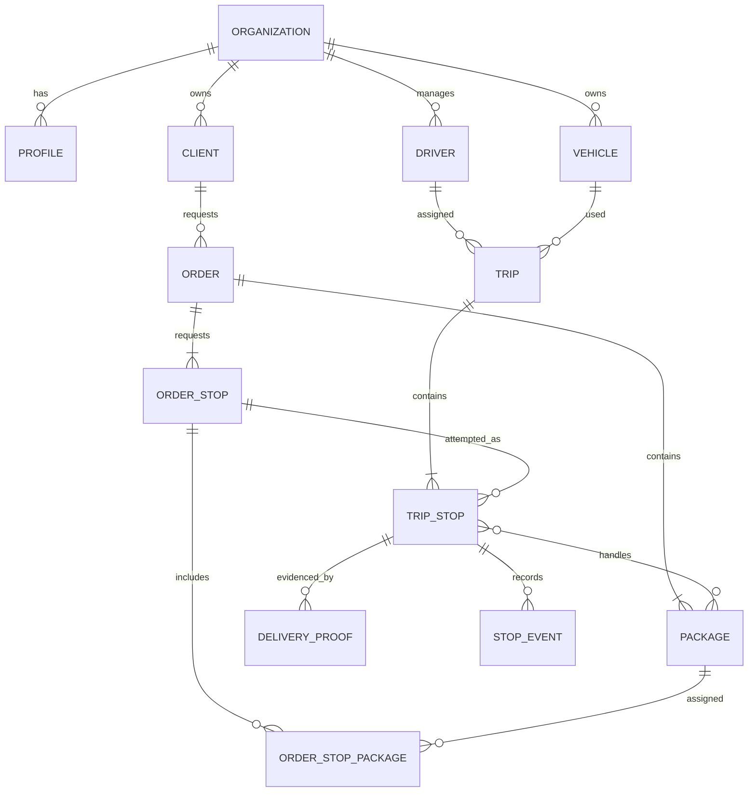

# Modelo funcional básico — MVP MalhaX

Este documento consolida o modelo operacional para validar antes de alterar ou aplicar migrations. O objetivo é cobrir múltiplas coletas e entregas na mesma viagem, cada uma com seu endereço e rastreabilidade simples, deixando regras avançadas para etapas seguintes.

## Entidades do MVP

| Entidade | Responsabilidade | Relações principais |
| --- | --- | --- |
| Organização (tenant) | Empresa cliente que usa o MalhaX; Activia é a primeira cadastrada. | Possui usuários, dados e permissões isolados; módulos disponíveis dependem do acesso contratado. |
| Perfil | Pessoa que acessa o sistema. | Pode ser motorista ou usuário de operação. |
| Motorista | Cadastro operacional, documentos e situação de aprovação. | Pode estar associado a um perfil e participar de viagens. |
| Veículo | Placa, tipo/modelo, capacidade e disponibilidade. | Associado à viagem em que foi utilizado. |
| Cliente | Contratante/remetente que solicita o serviço. | Pode possuir vários pedidos. |
| Pedido | Solicitação de transporte, referência do cliente, instruções e status. | Tem uma ou mais tarefas de coleta/entrega e um ou mais volumes. |
| Parada solicitada | Tarefa de coleta ou entrega com endereço e contato definidos antes do despacho. | Pertence ao pedido; quantidades independentes de cada tipo (X coletas e Y entregas). |
| Volume | Unidade física transportada, com código único e estado de custódia. | Pertence a um pedido e pode ser ligado às paradas da viagem. |
| Viagem | Execução atribuída a um motorista e veículo. | Contém paradas em sequência e pode atender vários pedidos. |
| Parada | Ação de coleta, entrega ou retorno em um endereço. | Pertence à viagem e pode agrupar pedidos/volumes do mesmo local. |
| Comprovante | Foto da entrega e foto do local, recebedor, horário da evidência e GPS com horário/precisão próprios quando disponível. | Pertence à parada e, quando aplicável, ao volume. |
| Evento/ocorrência | Histórico de mudanças e problemas de execução. | Vinculado à parada, viagem, pedido ou volume. |

## Fluxo principal

1. Cadastrar cliente, motorista e veículo.
2. Criar pedido com contratante, uma ou mais tarefas de coleta/entrega, cada uma com seu endereço, e volumes.
3. Gerar um código único para cada volume físico.
4. Montar uma viagem com X entregas e Y coletas, em quantidades independentes e sem proporção fixa. Cada parada recebe seu próprio tipo e endereço; depois, ordenar a sequência da rota.
5. Motorista aceita a viagem e atualiza cada parada: chegada, execução, concluída ou falha com motivo.
6. Na coleta/entrega, conferir os códigos esperados. Ao concluir entrega, salvar foto da entrega e da fachada/local, nome de quem recebeu e horário da evidência. GPS e horário da leitura são registrados separadamente quando disponíveis; a falta de GPS não bloqueia a entrega e deve ficar visível ao gestor.
7. Painel acompanha viagem, paradas, evidências e última localização recebida.

## Relação visual

## Recomendações para a primeira versão

- Um pedido pode ter X coletas e Y entregas, independentemente. Não há proporção fixa nem limite funcional definido neste modelo. Cada tarefa/endereço é cadastrada antes da viagem e pode ser atribuída a uma parada da rota.
- Um pedido pode ter vários volumes; cada código identifica uma unidade física, então cada registro de volume representa uma peça. Quantidade maior deve gerar várias peças/códigos.
- Uma viagem tem um motorista e um veículo e pode agrupar vários pedidos e paradas.
- Cada tarefa de coleta/entrega guarda endereço e contato antes do despacho. A parada da viagem recebe uma cópia desses dados, preservando o histórico se o endereço for corrigido depois.
- A localização do destino da parada é separada do GPS do comprovante: a primeira representa o endereço; o segundo registra onde o motorista estava ao executar.
- Falha parcial é registrada no nível do volume/parada para não marcar como entregue o pedido inteiro quando houver item pendente.
- Fotos podem ser múltiplas por parada/volume; arquivos ficam em armazenamento privado e o banco guarda metadados e caminho.

## Lacunas do schema atual

1. `orders` ainda não possui tarefas/endereço de coleta e entrega. `trip_stops` aceita várias paradas e endereços na viagem, mas esses endereços precisam estar registrados previamente para formar a fila de despacho.
2. `packages.quantity` permite que um único código represente várias peças; isso conflita com conferência individual por código.
3. `trip_stops.latitude/longitude` representa o ponto/endereço, enquanto `delivery_proofs.latitude/longitude` representa o GPS do motorista. A interface e os nomes devem manter essa diferença clara.
4. O schema permite comprovante com `package_id` vazio; a regra operacional precisa dizer quando a foto vale para a parada inteira e quando é obrigatória por volume.

## Estrutura de banco proposta

A migration `202610060006_order_stops_model.sql` adiciona `order_stops` antes do despacho e associa os volumes com `order_stop_packages`. `trip_stops.source_order_stop_id` registra qual tarefa aquela parada executa; `attempt_number` preserva reentregas e novas tentativas. Ela está aplicada no Supabase local; nenhuma migration foi aplicada em projeto hospedado.

## Fora do primeiro corte

Otimização automática de rotas, múltiplos motoristas por viagem, transferências complexas de custódia, fechamento financeiro detalhado, integração com WhatsApp e regras avançadas de acesso. A autenticação básica e o isolamento mínimo de dados continuam necessários desde o início.

## Proposta para fechar status, cadastro e comprovantes

### Status

| Objeto | Estados propostos | Regra resumida |
| --- | --- | --- |
| Pedido | `draft`, `pending_dispatch`, `partially_assigned`, `planned`, `in_progress`, `completed`, `exception`, `cancelled` | Derivado das tarefas e volumes: parcial quando parte das tarefas foi atribuída; planejado quando todas as tarefas estão em viagem; concluído quando todas as entregas previstas forem resolvidas. |
| Tarefa solicitada | `pending_dispatch`, `assigned`, `completed`, `exception`, `cancelled` | Representa cada coleta/entrega registrada no pedido; tarefa com falha pode voltar à fila para novo despacho. |
| Parada executada | `pending`, `arrived`, `in_progress`, `completed`, `failed`, `skipped` | Representa uma tentativa na viagem. Falha e salto exigem motivo; nova tentativa cria uma nova parada ligada à tarefa original. |
| Viagem | `draft`, `assigned`, `accepted`, `in_progress`, `paused`, `completed`, `cancelled` | Pausa e cancelamento exigem motivo. Uma parada com falha não encerra automaticamente as demais paradas da viagem. |
| Volume | `expected`, `picked_up`, `in_transit`, `delivered`, `returned`, `exception` | A leitura do código acompanha a custódia e permite identificar entrega parcial. |

### Cadastro do motorista

**Dados obrigatórios do motorista:** nome e sobrenome. O e-mail também é necessário para a conta e confirmação do convite; o status é controlado pelo sistema. Telefone e documentos ficam opcionais no MVP. A ativação continua condicionada à revisão do suporte.

**Dados opcionais para etapas posteriores:** telefone, documentos pessoais/da habilitação e documentos do veículo. A chave Pix pode ser cadastrada para repasse, mas não é necessária para habilitar o motorista a receber uma viagem.

### Comprovante de entrega

**Obrigatório para concluir entrega:** foto da entrega/mercadoria, foto da fachada/local, nome de quem recebeu e horário da evidência; também conferir os códigos dos volumes da parada. Latitude, longitude, precisão e horário da leitura GPS são um conjunto opcional: todos são registrados juntos quando houver posição válida, e todos ficam nulos quando o aparelho não fornecer GPS.

Assinatura fica opcional no primeiro corte. Sem câmera ou sem as duas fotos, não é possível concluir pelo fluxo normal; se o GPS estiver indisponível ou com baixa precisão, a entrega pode continuar e o painel sinaliza a ocorrência para análise.

### Regras de exceção sugeridas

- Falta de destinatário, recusa, endereço incorreto, avaria e divergência de volume exigem motivo e podem receber foto.
- Uma entrega parcial conclui apenas os volumes confirmados; os restantes ficam pendentes ou em exceção para novo despacho.
- Coordenadas, precisão e horário da leitura GPS são salvos como recebidos pelo aparelho, separados do horário da evidência e do recebimento pelo servidor; a interface sinaliza ausência/baixa precisão e preserva os valores originais.
- A tolerância de precisão que exige intervenção deve ser configurável e definida com a operação após um piloto de campo.

